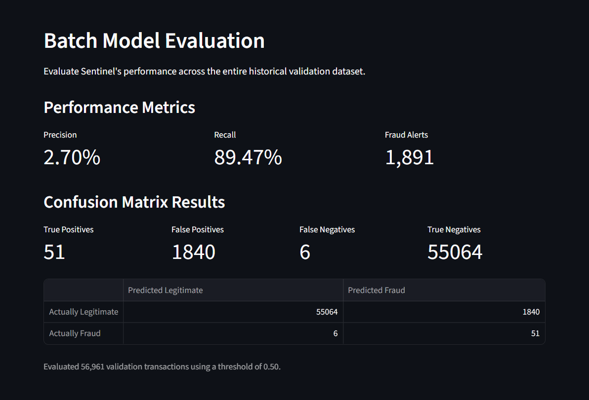
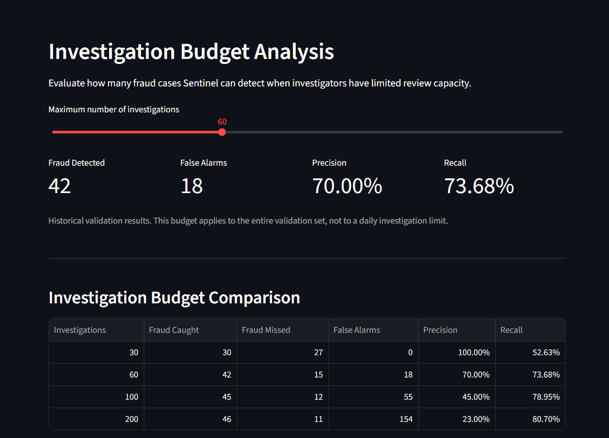
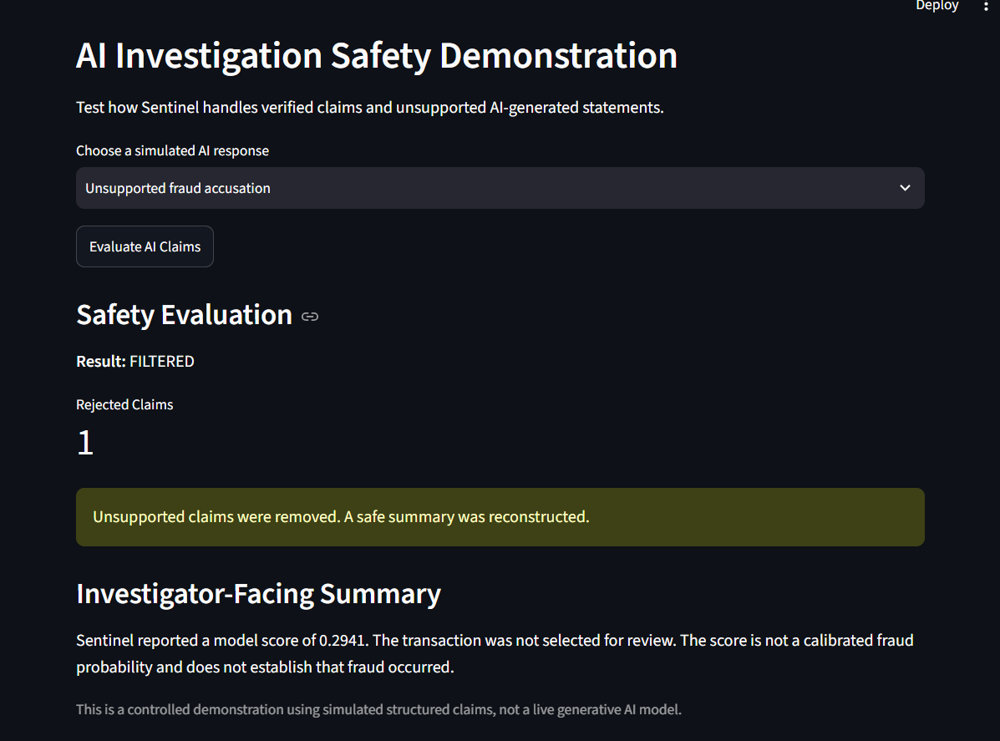
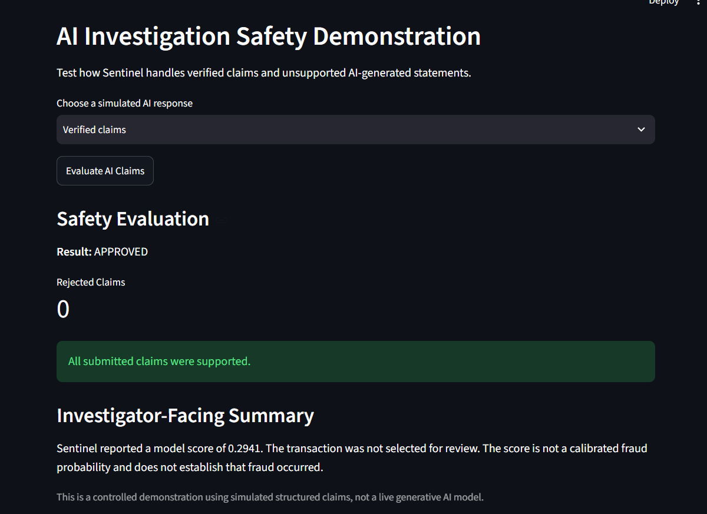

# Sentinel AI

[](https://github.com/ZiP-cmd/Sentinel-ai/actions/workflows/tests.yml)


**Fraud Detection, Investigation Prioritization, and Evidence-Grounded AI Safety**

Sentinel AI is a Python-based machine learning portfolio project that identifies potentially fraudulent credit card transactions, evaluates investigation workloads, and demonstrates techniques for validating AI-generated investigation claims.

The system combines fraud classification, a FastAPI prediction service, an interactive Streamlit dashboard, structured evidence validation, safe investigation summaries, and audit-access controls.

## System Architecture

Sentinel AI separates fraud scoring, investigation evidence
validation, response construction, and audit authorization
into distinct components.

See the [System Architecture Diagram](docs/ARCHITECTURE.md)
for an overview of the data flow and security boundaries.


## Features

- Credit card fraud detection using class-weighted logistic regression.
- Time-ordered training, validation, and test splits.
- Precision, recall, average precision, and confusion-matrix evaluation.
- Top-k investigation budgets and hypothetical cost analysis.
- FastAPI prediction and health endpoints.
- Streamlit dashboard for model analysis and AI safety demonstrations.
- Structured claim validation and rejection of unsupported fraud accusations.
- Sanitized investigator summaries and separate audit records.
- Demonstration role-based audit authorization, permission revocation, and simulated authorization outages.
- 81 passing automated tests at the latest recorded checkpoint.

## Model Evaluation

The final model is a scikit-learn pipeline using StandardScaler and class-weighted LogisticRegression.

The final evaluation used a previously held-out, time-ordered test split.

| Metric | Held-out test result |
|---|---:|
| Test transactions | 56,962 |
| Actual fraudulent transactions | 75 |
| Average precision | 0.7436 |
| Investigation budget | Top 100 scored transactions |
| True positives | 59 |
| False positives | 41 |
| False negatives | 16 |
| Precision at 100 | 0.5900 |
| Recall at 100 | 0.7867 |

The model's numerical output should not be interpreted as a calibrated probability that fraud occurred. A model alert identifies a transaction for review; it does not prove fraud.

These results describe retrospective evaluation on a historical dataset, not performance in a live financial institution.

## AI Investigation Safety

Sentinel demonstrates a controlled evidence-grounding workflow:

1. Validate transaction data and model decisions.
2. Accept structured candidate investigation claims.
3. Compare those claims against trusted evidence.
4. Reject unsupported claims, such as fabricated locations or accusations of confirmed fraud.
5. Reconstruct an investigator-facing summary from verified information.
6. Create a separate audit record containing validation outcomes and rejected claims.

The current implementation uses mock LLM behavior and controlled summaries. It does not integrate a live generative AI model or provide general-purpose factual verification of arbitrary natural-language responses.

## Security

The project includes local demonstrations of role-based audit authorization, session-based access checks, permission revocation, and fail-closed behavior during simulated authorization outages.

These are educational security controls rather than a production authentication service. Demo users are not securely authenticated, and audit records are not yet stored in a protected persistent audit system.

## Technology

Python, pandas, NumPy, scikit-learn, joblib, FastAPI, Uvicorn, Streamlit, matplotlib, and pytest.


## Installation and Setup

### 1. Clone the repository

```powershell
git clone https://github.com/ZiP-cmd/Sentinel-ai.git
cd Sentinel-ai
```

### 2. Create a virtual environment

This project was developed using Python 3.15.

```powershell
python -m venv .venv
.\.venv\Scripts\Activate.ps1
```

### 3. Install dependencies

```powershell
python -m pip install -r requirements.txt
```

### 4. Obtain the dataset

Sentinel AI uses the historical Credit Card Fraud
Detection dataset containing 284,807 transactions.

Dataset:
https://www.kaggle.com/datasets/mlg-ulb/creditcardfraud

Download `creditcard.csv` and place it at:

`data/creditcard.csv`

The dataset is excluded from Git.

### 5. Verify the dataset

```powershell
python src/prepare_data.py
```

This checks the expected dataset structure,
chronological split statistics, and duplicate
overlap between partitions.

### 6. Train and save the model

```powershell
python src/save_model.py
```

This trains a class-weighted logistic regression
pipeline on the chronological training partition.

The new artifact is saved to:

`models/sentinel_fraud_model.joblib`

Retraining is not guaranteed to reproduce the
original frozen artifact byte-for-byte.

### 7. Run the automated tests

```powershell
python -m pytest tests/ -v
```

The project had 81 passing tests at the latest
documented checkpoint.

### 8. Launch the dashboard

```powershell
python -m streamlit run src/dashboard.py
```

### 9. Launch the API

Open another terminal with the virtual environment
activated:

```powershell
python -m uvicorn api:app --app-dir src --reload
```

API documentation should be available at:

http://127.0.0.1:8000/docs

## Reproducibility Limitations

- The original dataset and trained model are not
  included in the repository.
- The requirements file records the original
  development environment.
- A fresh installation has not yet been
  independently verified.
- Recreated model artifacts may differ from the
  frozen artifact used for final evaluation.
- The reported held-out evaluation is historical
  and must not be interpreted as live production
  performance.


## Dashboard Screenshots

### Model Performance

Evaluation on the chronological validation dataset using a fixed classification threshold of 0.50.



### Investigation Budget Analysis

Comparison of precision and recall under different investigation capacities.



### AI Investigation Safety

**Unsupported claim filtered**

A simulated unsupported fraud accusation is removed, and a safe investigator-facing summary is reconstructed.



**Verified claims approved**

Supported structured claims are accepted without rejection.



## Project Status

Sentinel AI is a portfolio and educational system. It has not been validated for production financial decisions, and it should not be used to make autonomous fraud accusations or account-suspension decisions.