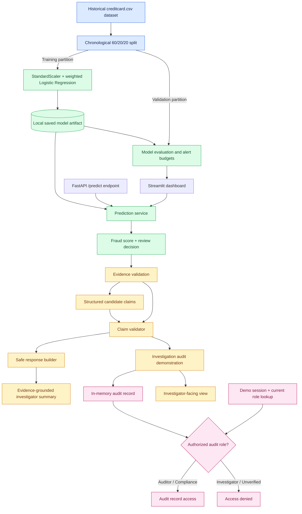

# Sentinel AI — System Architecture

Sentinel AI is an educational fraud detection and investigation
safety demonstration. Its model, dashboard, API, and audit
demonstrations are not a production financial decision system.

## Architecture Diagram



## Major Components

### Machine Learning
- `src/save_model.py`: trains the selected model
- `src/prediction_service.py`: loads and scores transactions
- `src/model_evaluation.py`: evaluates model predictions
- `src/alert_budget.py`: evaluates fixed investigation capacities

### Interfaces
- `src/dashboard.py`: Streamlit model and safety demonstrations
- `src/api.py`: FastAPI prediction and health endpoints

### Evidence-Grounded Investigation
- `src/investigation_evidence.py`: validates prediction evidence
- `src/claim_validator.py`: checks structured claims
- `src/safe_response_builder.py`: reconstructs safe summaries
- `src/investigation_audit.py`: creates separate in-memory
  investigator views and audit records

### Demonstration Security
- `src/audit_sessions.py`: demo sessions and current-role lookup
- `src/audit_access.py`: role-based audit record access

## Important Design Boundaries

The FastAPI service provides model predictions; it does not
expose the complete investigation and audit workflow.

The Streamlit dashboard demonstrates prediction, evaluation,
and selected investigation-safety scenarios.

The audit workflow is implemented and tested as a separate
in-memory demonstration rather than a persistent audit service.

The claim validator checks known structured fields against
trusted evidence. It is not a general-purpose natural-language
fact-checking system.

Model alerts require human interpretation and do not establish
that fraud occurred.
```
